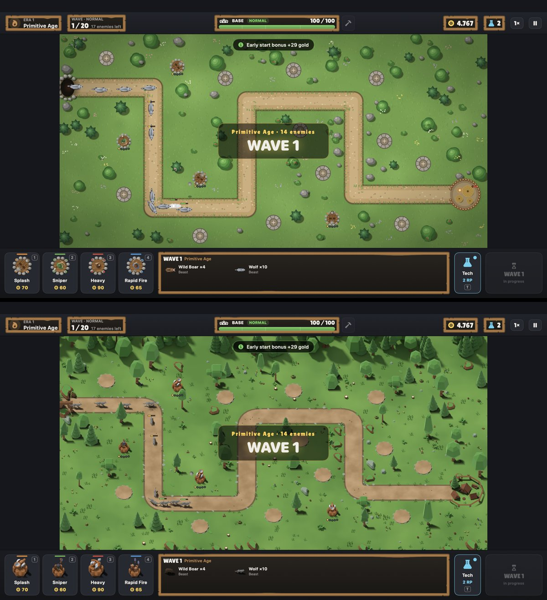

# Evolution Defense: Visual Asset Overhaul, Final Report

The plan this implements is [ART_OVERHAUL_PLAN.md](ART_OVERHAUL_PLAN.md)
(Option A, 3/4 view, Kenney sound effects). Technical details are in
[ASSETS.md § 7](ASSETS.md#7-the-shipped-25d-pack-and-how-it-is-made). Licences are in
[ASSET_LICENSES.md](ASSET_LICENSES.md).



## 1. Art direction

**Stylized 2.5D low-poly tabletop.** Chunky low-poly models are seen from a
fixed 3/4 angle (orthographic, 55° elevation) under one warm sun from the
upper left. They cast real soft shadows on a painted meadow.

* **Style references** (visual only, no assets taken from them): Kingdom Rush
  for tower readability and upgrade escalation, Bad North for lighting and the
  tabletop depth, Iron Marines for creature silhouettes and combat effects.
* **One look from many packs.** Every model passes through the same palette
  grade (`Tools/bake/palette.py`), lighting rig, camera and material clean-up.
  This turns Kenney's teal and salmon and Quaternius's varied palettes into a
  single natural palette.
* **Readability.** Towers carry an archetype accent colour (splash orange,
  sniper green, heavy red, rapid blue) on their trim. They grow taller and more
  elaborate from level 1 to level 5, and level 5 adds glowing energy cores.
  Enemies keep their silhouettes. Bosses are larger and some glow (alpha beast
  eyes, titan tint). Gameplay elements are always drawn above decoration.
* **UI.** A carved-wood frame (Kenney UI Adventure) on dark panels, parchment,
  stone and red buttons, and the Lilita One display face for titles, numbers
  and floating combat text.

## 2. Sources

| Source | What it gave | Preview |
|---|---|---|
| Kenney Tower Defense, Castle, Nature, Space, Blaster kits; Mini Characters | Towers, crews, bases, props, trees, projectiles | <https://kenney.nl/assets/tower-defense-kit>, <https://kenney.nl/assets/castle-kit>, <https://kenney.nl/assets/nature-kit>, <https://kenney.nl/assets/space-kit>, <https://kenney.nl/assets/blaster-kit>, <https://kenney.nl/assets/mini-characters> |
| Quaternius Ultimate Animated Animals | Wolves, bear, beasts, stag | <https://quaternius.com/packs/ultimateanimatedanimals.html> |
| Quaternius Monster / Cute Monster / Robot / Mech packs (OpenGameArt) | Dragon, bat, slime, troll, crab, cyclops, titan, robots, mechs | <https://opengameart.org/content/lowpoly-animated-monsters>, <https://opengameart.org/content/textured-cute-monster-pack>, <https://opengameart.org/content/animated-lowpoly-robot>, <https://opengameart.org/content/animated-mech-pack> |
| Boar by Teh_Bucket (OpenGameArt) | Wild boar | <https://opengameart.org/content/boar> |
| Kenney Particle Pack | Every effect and energy projectile | <https://kenney.nl/assets/particle-pack> |
| Kenney UI Pack – Adventure | Panels and buttons | <https://kenney.nl/assets/ui-pack-adventure> |
| Kenney Interface, Impact, Sci-fi Sounds; RPG Audio | 27 sound effects | <https://kenney.nl/assets/interface-sounds> … |
| Lilita One (Google Fonts) | Display font | <https://fonts.google.com/specimen/Lilita+One> |

## 3. Licensing

All art and audio is **CC0 1.0**. The font is **SIL OFL 1.1**. Nothing comes
from a commercial game. The full per-pack inventory (source URL, author,
licence, download date, usage) is in [ASSET_LICENSES.md](ASSET_LICENSES.md),
and the licence texts are in `ThirdParty/Licenses/`. Raw source packs are
downloaded by `Tools/bake/fetch-sources.sh` and git-ignored. Only rendered
sprites, converted sounds and the font are shipped. The OFL ships next to the
font in the app.

## 4. Assets replaced and added

The shipped manifest has **96 sprites**: 90 replace placeholders and 6 are new.
Every replacement goes through the asset manifest, so no gameplay code
references a file.

| Group | Count | Replaced / new | Frames |
|---|---|---|---|
| Map background | 1 | replaced: rendered meadow with road, edging, rocks, flowers, forest border | 1 (1600 × 800 pt) |
| Build pad, highlighted pad, spawn | 3 | replaced: dirt pads with stone ring, cave in a cliff | 3 |
| Era bases | 4 | replaced: tents and fence, stone castle, castle with chimneys and generator, futuristic hangar | 4 |
| Tree and pine decorations | 2 | **new**: depth-sorted standing trees (6 + 5 variants) instead of flat discs | 11 |
| Tower bases | 20 | replaced | 20 |
| Tower weapons | 20 | replaced: 16 aim directions, idle plus 2-frame recoil | 960 |
| Enemies and bosses | 19 | replaced: 8 directions, 8-frame distance-driven walk, 6-frame death (boar: walk only) | 2,080 |
| Projectiles | 17 | replaced: 12 physical (baked) + 5 energy (particle textures) | 17 |
| Effects | 6 + 4 | replaced: explosion, puff, spark, ring, shield, missile. **New**: muzzle flash, scorch mark, ember and smoke particle textures | 9 images |
| UI skin | 7 image sets | **new**: panel frame, wood panel, 3 button styles, banner, round button | — |
| Sound effects | 27 of 35 | replaced: recorded (the other 8 and the music stay synthesized) | — |
| Font | 1 | **new**: Lilita One | — |

**Kept as code-drawn art (on purpose):** `fx.shadow` (projectile ground
shadow), `fx.disabled` (stunned-tower icon) and `ui.levelPip.on` /
`ui.levelPip.off` (level dots). These are simple glyphs where flat
code-drawn art reads best. The whole placeholder pack remains as a fallback
layer underneath.

## 5. Directory structure (new and changed)

```
Docs/
├── ART_OVERHAUL_PLAN.md          Stage 1 audit and approved plan
├── ART_OVERHAUL_REPORT.md        this report
├── ASSET_LICENSES.md             licence and attribution inventory
└── ASSETS.md                     + § 7: 2.5D pack, pipeline, rendering, memory
ThirdParty/Licenses/              Kenney License.txt ×12, CC0-1.0.txt, LilitaOne-OFL.txt
Tools/
├── bake/
│   ├── fetch-sources.sh          downloads every source pack (+ provenance files)
│   ├── view.json, palette.py     camera/light constants, shared colour grade
│   ├── prepare_textures.py       graded RGBA copies of kit textures
│   ├── blender/rig.py            shared Blender scene, import, materials
│   ├── blender/bake_env.py       background, trees, pads, spawn, bases
│   ├── blender/bake_towers.py    20 tower levels
│   ├── blender/bake_enemies.py   19 enemies
│   ├── blender/bake_projectiles.py
│   ├── package.py                trim, atlases, effects, manifest
│   └── sources/, out/            (git-ignored)
└── audio/convert.py              Kenney OGG → WAV + audio_manifest.json
EvolutionDefense/
├── Assets.xcassets/Baked/        Environment, Towers, Enemies1–4, Combat .spriteatlas,
│                                 env_meadow_background
├── Assets.xcassets/UI/           9-slice skin
├── AssetPack/
│   ├── asset_manifest.json       generated 2.5D pack
│   ├── asset_manifest.placeholder.json   procedural fallback (always loaded first)
│   ├── audio_manifest.json, Audio/sfx_*.wav
│   └── Fonts/LilitaOne-Regular.ttf, LilitaOne-OFL.txt
├── Rendering/Shaders.swift       status and dissolve SKShaders
└── …
Packages/EvolutionDefenseCore/Sources/edtool/   exports map geometry for the bake
```

## 6. Rendering changes

All of these are visual only. Each one falls back to the old behaviour with the
placeholder pack.

* **2.5D view projection** (`ViewProjection`): the flat simulation is drawn
  onto the 3/4 view, with units sorted by ground depth (flyers above), range
  and blast circles drawn as ellipses, and mouse input unprojected.
  Configured by the pack's `view.*` layout keys; the identity for top-down packs.
* **Directional sprites** (new `facing: "directional"` + `directions`):
  pre-rendered angles instead of rotating the sprite. Tower heads use 16, enemies 8.
* **Status shader:** a real white hit flash, plus stun, burn, frost and enrage
  tints. Per-sprite `SKAttribute`, so batching is kept.
* **Dissolve shader** on death animations, with an ember rim.
* **Pooled `SKEmitterNode` bursts:** embers and smoke on explosions and boss
  deaths. Capped at 14, off in performance mode.
* **Ground-plane effects** (squashed rings, scorch marks) and **directional
  muzzle flashes** at the weapon's height.
* **Depth-sorted decorations** from the map data, the 9-slice SwiftUI skin,
  and the display font (SwiftUI and SpriteKit labels).
* **Icons** are trimmed to the subject, so tower cards show the tower, not its
  padding.

## 7. Performance and memory

Measured on an M1 MacBook Air (8 GB), release build, worst-case scene:
16 level-5 towers, every tech, about 300 Futuristic enemies plus the final boss.

| | Placeholder art | Baked 2.5D pack |
|---|---|---|
| Average FPS (normal / performance mode) | 60.0 / 59.6 | **60.0 / 60.0** |
| p99 frame time | 17.7 ms | 17.6 ms |
| Frames over 20 ms (of about 500) | 0 / 3 | **0 / 0** |
| Process footprint | 241 MB | **501 MB** |
| GPU textures | 48 MB | 177 MB |
| App bundle | — | 44 MB |

The first baked build used **936 MB**. Three changes brought it to 501 MB:

1. Enemy atlases are loaded per era (current and next), and earlier eras are
   released on era change. GPU textures went from 504 to 348 MB.
2. Enemy frames are stored at 1.5 px per point, which is lossless at the
   on-screen scale. Down to 241 MB.
3. Shadow haze is removed and shadows are feathered before trimming, so
   atlases pack tighter. Down to 177 MB.

## 8. Screenshots

`Scripts/snapshot.sh` (scripted match, all eras, menus and overlays) writes
`snapshots/01…22-*.png`. Highlights:

In the repository (`Docs/images/`): [before / after](images/before-after.jpg),
[menu](images/menu.jpg), [upgrade panel](images/upgrade-panel.jpg),
[alpha beast](images/boss-alpha.jpg), [dragon](images/dragon.jpg),
[futuristic era](images/futuristic.jpg). The full set is generated locally
(`snapshots/` is git-ignored):

* `snapshots/before-after.png`: same moment, placeholder art and 2.5D pack.
* `01-menu.png`: skinned menu and display font.
* `06-upgrade-panel.png`: wood-frame panels, tower card icons.
* `10-boss-alpha.png`, `14-dragon-fire-breath.png`, `16-mutant-titan.png`, `18-titan-overdrive.png`: bosses, effects, scorch marks.
* `12-medieval-wave.png`, `15-industrial-wave.png`, `17-futuristic-wave.png`: each era's enemies and towers.
* `asset-pack-sample.png`: the override-pack path still layers on top.

## 9. Gameplay is unchanged

* **No balance data changed.** Tower damage, rate, range and costs; enemy HP,
  speed, armour and abilities; waves, difficulty and the tech tree are all
  untouched. The only data additions are optional visual keys
  (`TowerDefinition.visual`, `TowerLevelStats.projectileVisual`), and they default
  to the previous values.
* **Simulation untouched.** Pathing, collision, hit radii and targeting still
  run in flat world space. The 2.5D projection is applied only when drawing,
  and its inverse only when reading the mouse. `Projectile.visual` is a
  cosmetic tag set when a shot is fired.
* **Saves:** no persisted format changed. Old saves and profiles load.
* **Tests:** all **110** tests pass (`Scripts/test.sh`), including the balance,
  save, wave and asset-manifest suites. The shipped pack is validated on top
  of the placeholders, and every atlas frame it references is checked to exist.
* **Audio:** `EVO_AUDIO_CHECK=1` reports 35/35 effects playable (27 recorded),
  peak 0.98 (no clipping).

## 10. Known limitations and possible follow-ups

* The boar has no death animation in its source rig, so it uses the
  fade-and-shrink corpse.
* The tower crews (Kenney Mini Characters) are small at play size and read
  as detail rather than as figures.
* The music is still the synthesized score. A recorded CC0 soundtrack could
  replace it through the same `audio_manifest.json` path.
* Re-baking everything takes about 2½ hours on the M1. Each Blender script
  accepts `-- only=<name>` for single items.
