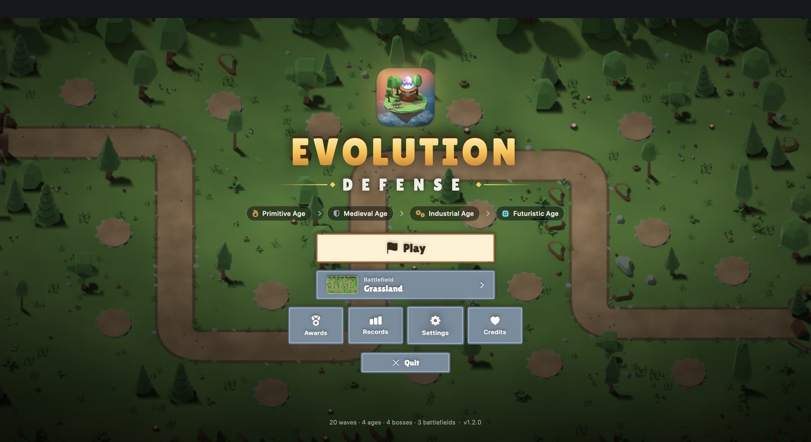
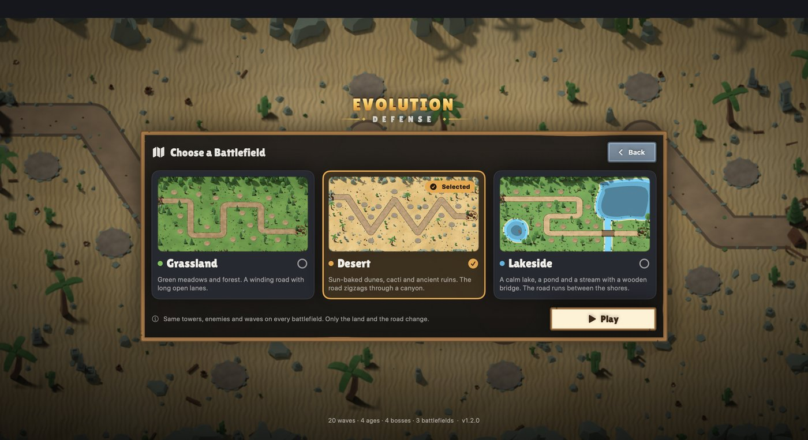
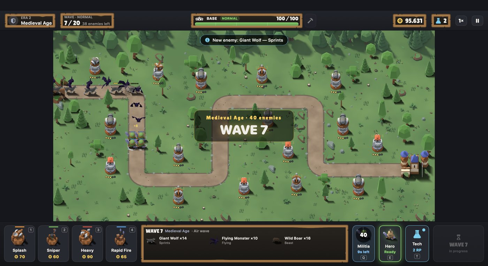
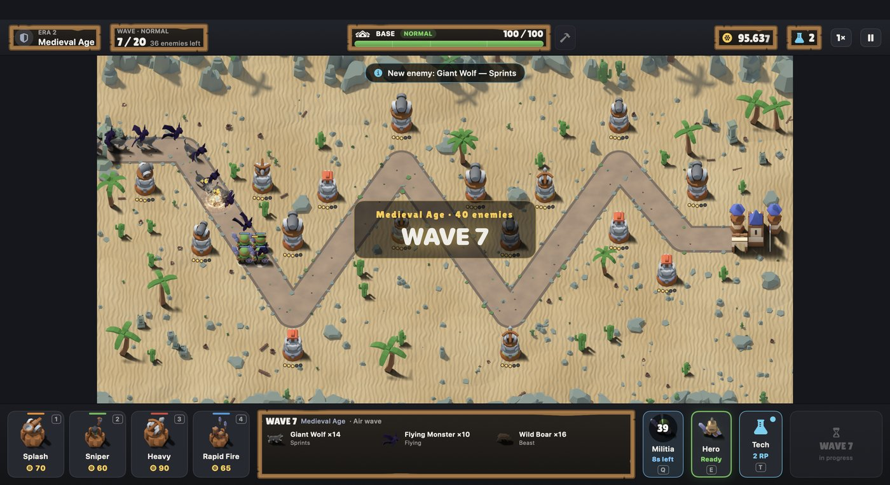
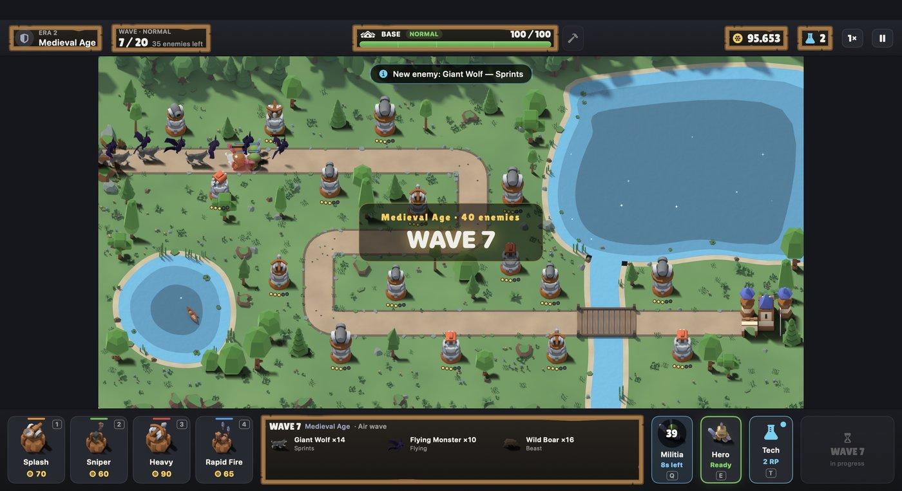

# Evolution Defense: Menu Polish and Battlefields

Three battlefields (Grassland, Desert, Lakeside), a battlefield selection
screen, and a polished main menu. Gameplay rules are unchanged: the same
towers, enemies, waves, summons and difficulty run on every battlefield.

| Main menu | Battlefield selection |
|---|---|
|  |  |

| Grassland | Desert | Lakeside |
|---|---|---|
|  |  |  |

## 1. Main menu

* **Logo lockup:** the game's emblem above a gold-gradient title with an
  ornament line. It shrinks to one line while a menu screen is open.
* **Backdrop:** the selected battlefield, softly blurred with a vignette. It
  cross-fades when you pick another battlefield.
* **Buttons:**
  * Play (or Continue + New Game when a save exists).
  * Battlefield, showing the current choice with a thumbnail.
  * Awards, Records, Settings, Credits.
  * Quit.
* **Feedback on every button** (`GameButtonStyle`, `CardButtonStyle` in
  `UI/Theme.swift`): lifts and brightens on hover, dips when pressed, greys
  out when disabled. This applies in the game's panels too.
* **Transitions:** menu screens slide up and fade in; the menu fades in on
  launch.
* **Credits** screen: art, sound and font authors and licences.

## 2. Battlefield selection

Three cards, each with a rendered preview (the real map with its trees, pads,
spawn and base), name, description, a colour accent and a "Selected" badge.
Click to select; **Play** continues to the New Game screen (difficulty), which
also shows the battlefield with a **Change** button; **Back** returns.

The choice is stored in the player's settings (`GameSettings.battlefield`) and
in every match's options (`MatchOptions.battlefield`), so Continue and Restart
use the right map. Saves from before battlefields existed load as Grassland.

## 3. Battlefield configuration

A battlefield is one JSON file in
`Packages/EvolutionDefenseCore/Sources/EvolutionDefenseCore/Resources/Config/`,
listed in `battlefields.json` (menu order; the first is the default):

| Field | Meaning |
|---|---|
| `id`, `name`, `summary` | Identifier, display name, card description |
| `theme` | `environment` (which art builder: `grassland`, `desert`, `lakeside`), ground, road and water colours, menu accent |
| `tileSize`, `columns`, `rows`, `pathWidth` | Playfield (all three are 32 × 16 tiles) |
| `path`, `spawn`, `base` | The enemy road (any angles), where it starts and ends |
| `buildSlots` | Tower pads |
| `decorations`, `scatter` | Hand-placed and seeded decorations (`tree`, `pine`, `rock`, `boulder`, `bush`, `flowers`, `cactus`, `palm`, `ruin`) |
| `water`, `bridges` | Water outlines (visual; nothing is built or scattered there) and bridges where the road crosses |
| `ambient` | Ambient effects: `dust`, `waterSparkle` |

`GameConfiguration.maps` holds all battlefields. A match plays on
`config.selecting(battlefield:)`, so the simulation only ever sees "the map"
and nothing in gameplay code is battlefield-specific.

**Checked when the game loads** (a bad map file is rejected, not played):
pads inside the playfield, on dry land and clear of the road; the road enters
water only on a bridge; unique ids.

| | Grassland | Desert | Lakeside |
|---|---|---|---|
| Road | Square S-bends | Zigzag "W" with diagonal legs | Three rows between the shores, over a bridge |
| Road length | 2,745 | 2,660 | 2,695 |
| Pads | 16 | 16 | 16 |
| Scenery | Meadow, forest | Sand ripples, stones, cacti, palms, ruins, rocky rim | Lake, pond with a canoe, stream, plank bridge, reeds, lilies |
| Ambient | — | Drifting dust | Sun glints on the water |
| Own sprites | Shared set | Stone pads, stone spawn cave, cactus / palm / ruin sprites | Background only (reuses Grassland's trees, pads, spawn) |

### Adding a battlefield

1. Write `map_<id>.json` and add it to `battlefields.json`.
2. `swift run --package-path Packages/EvolutionDefenseCore edtool export-map ../../Tools/bake/map.<id>.json <id>`
3. `blender -b --factory-startup -P Tools/bake/blender/bake_env.py -- map=<id>`
   (a new `environment` needs a builder function in that script).
4. `python3 Tools/bake/package.py`, then `Scripts/generate-placeholder-manifest.py`.
5. `edtool balance-summary map=<id>` to compare its difficulty.

## 4. Rendering

* `ArtLibrary` looks up `map.<id>.background`, and `map.<id>.slot` /
  `map.<id>.spawn` when a battlefield has its own (otherwise the shared ones).
  Decorations use `deco.<kind>` sprites, depth-sorted with units.
* Only the battlefield in play keeps its background texture (20 MB). Starting
  a match on another map releases the previous one's background, pads, spawn
  and decoration sprites. Menu previews are small composited images.
* Ambient effects live in `MapRenderer` and are off in performance mode.
* Desert roads use a stroke-style mesh with round joins, so sharp corners
  never fold and the road always contains the enemies' path.

## 5. Assets and licences

Everything new is rendered from the **Kenney Nature Kit (CC0)**, already in
[ASSET_LICENSES.md](ASSET_LICENSES.md): cacti, palms, statues and columns,
stones, lilies, bamboo reeds, canoe. The water, sand, dunes, road and bridge
are built in the Blender script. No new packs were added.

## 6. Testing

| Check | Result |
|---|---|
| `BattlefieldTests` (10): three maps load; layouts comparable; pads and decorations on valid ground; road crosses water only on a bridge; Grassland unchanged; every pad buildable, enemies reach the base, summons deploy on each map; old saves load; checkpoints keep the battlefield; difficulty pattern holds | ✅ |
| Grassland's road, pads and all 169 seeded decorations compared with the export made before this change | identical |
| `Scripts/battlefield-test.sh`: menu, selection, a wave-7 fight on each map, map switching leaves one background in memory | ✅ PASS |
| Full suite | 155 tests pass |
| `summon-test.sh`, `death-test.sh` | ✅ PASS |
| Benchmark (300 enemies + boss) | 60.0 fps, 0 frames over 20 ms |

**Difficulty on Normal** (5 seeds; wins, or average furthest wave):

| Strategy | Grassland | Desert | Lakeside |
|---|---|---|---|
| Expert (8 mixed, tech) | 5/5 | 4/5 | 5/5 |
| Spread (12 towers) | wave 16.6 | 17.2 | 17.6 |
| No tech / casual | 14.8 / 13.8 | 17.0 / 16.2 | 17.0 / 17.0 |
| Snipers only | 17.0 | 17.0 | 17.0 |
| Level-1 spam | 9.0 | 9.0 | 9.0 |

## 7. Limitations

* The new maps play about two waves easier in the mid-game for weaker
  strategies (more spots cover two stretches of road), while the final boss is
  a little harder on Desert. Grassland's reference plan is hand-made and the
  others are generated, so part of the gap is the plan, not the map.
* On Easy, a no-tech defence can still lose the final boss on Desert.
* Records are kept per difficulty, not per battlefield.
* Water is static apart from the sparkles; there is no wave animation.
* A few tiny dark specks remain where the stream meets the lake.
* The code-drawn fallback pack draws the new maps as plain themed ground,
  water and road.
