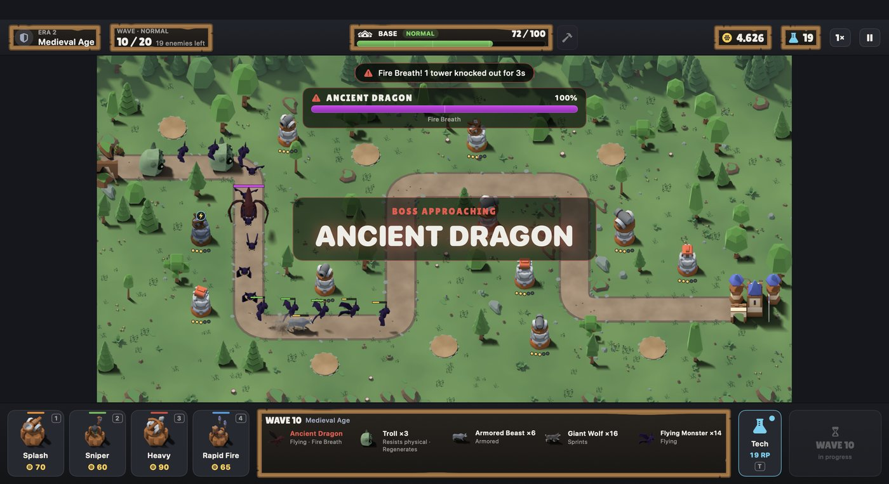

# Evolution Defense



A native macOS 2D tower defense game (Swift · SwiftUI · SpriteKit). Target: Apple Silicon, M1 / 8 GB minimum,
macOS 14+.

## Status

| Phase | Scope | Status |
|---|---|---|
| 1 | Core prototype: app, menu, winding map, enemy movement, tower placement, 4 archetypes, projectiles, enemy HP, base HP, combat | ✅ |
| — | Migration from pure SwiftPM to an Xcode app project + local Swift package | ✅ |
| 2 | Wave manager with preparation countdown, gold economy, 5-level upgrades + selling, base repair, wave summaries | ✅ |
| 3 | 4 eras / 20 waves, enemy abilities, 4 bosses (multi-phase final boss), tech tree, Research Points | ✅ |
| 4 | Polish: audio, animations, random events, difficulty, achievements, saves, perf mode | ✅ |
| — | Visual overhaul: 2.5D tabletop art baked from CC0 3D kits, particle effects, shaders, UI skin, recorded sound effects | ✅ |

Version **1.0.0**. See *Art & audio* below and [Docs/ASSETS.md](Docs/ASSETS.md) § 7.

### Polish (Phase 4)

* **Difficulty:** Easy, Normal and Hard, chosen under New Game. `difficulty.json` sets enemy HP and speed, a
  gold multiplier, starting gold and RP, and the countdown length. Checked by the balance tests:
  * **Easy:** even a sloppy defence wins.
  * **Normal:** a focused defence wins without tech.
  * **Hard:** needs the tech tree (scripted players win with tech at about 55 HP and lose without it).
* **Random events** (optional, on by default) happen every 3–4 waves. They are defined in `events.json`:
  * *Resource Bonus:* gold.
  * *Technology Boost:* the next tech costs 2 RP less.
  * *Reinforcement:* a temporary allied tower, one level above the current era, holds a free pad for one wave.
  * *Enemy Mutation:* the next wave has +20 % HP and +10 % speed but pays +50 % gold.
  * *Mechanical Breakdown:* one tower attacks 50 % slower for one wave.

  Negative events are mild and last one wave. A test checks that the focused player still wins with events
  on, on every difficulty and seed tried.
* **Achievements:** 18 of them in `achievements.json`, such as one per boss, *Complete Arsenal*, *Golden Age*,
  *Blitz*, *The Old Ways* (win without tech) and *Against All Odds* (win on Hard). A medal toast shows when one
  unlocks, the end screen lists them, and the menu has a gallery.
* **Save system** (JSON, atomic writes, App Sandbox container):
  * `profile.json` holds settings, unlocked achievements, per-difficulty records (matches, wins, highest wave,
    fastest win, best HP), technologies ever researched and lifetime totals.
  * `checkpoint.json` stores the match at the start of every preparation phase, on *Save & Main Menu* and on
    quit. **Continue** on the main menu resumes from it. Mid-wave progress isn't saved, so you resume from the
    start of that wave's preparation. A test checks that a resumed match plays out identically to the original.
  * Missing fields in older files fall back to defaults. A corrupt file is moved aside instead of crashing.
* **Audio** (AVAudioEngine): 35 sound effects and a music loop for each era plus the menu:
  * The music cross-fades when the era changes.
  * Effects play on a pool of 14 player nodes, with per-sound rate limits so heavy fights stay readable.
  * Master, music and effects volumes can be set, and music and effects can be turned off.
* **Animations & feedback:**
  * Screen shake on boss arrival, boss phase changes, EMP and base hits (can be turned off).
  * Muzzle flashes.
  * Dying enemies fade instead of vanishing.
  * Bosses "breathe".
  * Era transitions.
* **Performance mode** (Settings) caps effects at 60 and drops floating numbers, muzzle flashes, corpses,
  projectile shadows and shimmer. **Benchmark** (`Scripts/benchmark.sh`, Release build on this Mac): 16
  level-5 towers, all tech, about 300 Futuristic enemies plus the final boss. Results:
  * Normal mode: **59.9 fps average**, 1 frame over 20 ms in 8 s.
  * Performance mode: **60.0 fps**, 0 frames over 20 ms.

### Evolution (Phase 3)

* **Four eras, 20 waves.** Five waves per era, with a boss on waves 5, 10, 15 and 20. When an era ends, the
  map re-tints and the base evolves: village → stone keep → factory → energy citadel.
* **19 enemies with their own behaviours**, not just more HP:

  | Era | Enemies | Boss |
  |---|---|---|
  | Primitive | Wolf, Wild Boar, Bear | **Alpha Beast**: howls for wolves, enrages below 50 % HP |
  | Medieval | Giant Wolf (sprints), Armored Beast (armor), Troll (resists physical, regenerates), Flying Monster | **Ancient Dragon**: flies; Fire Breath knocks out nearby towers, Inferno phase |
  | Industrial | Mutant Beast (regenerates), Armored Monster (resists explosive), Giant Mutant (splits in 3), Swarm Creature | **Mutant Titan**: regenerates, releases swarms as it is wounded, Frenzy phase |
  | Futuristic | Scout Robot, Assault Robot (energy shield), Heavy Mech (huge armor), Stealth Robot (cloaks) | **Titan War Machine**: phase 2 adds EMP Blast, Missile Strike, reinforcements and speed. It destroys the base if it arrives |

* **Damage types.** Each tower level deals physical, explosive or energy damage. Enemies resist types by a
  percentage, applied before armor. Energy damage breaks shields 50 % faster. Splash damage hits cloaked
  enemies. Sniper level 4+ and Orbital Strike see stealth.
* **Tower specials at high levels:** Heavy Artillery and Plasma Artillery slow, Rocket Launcher and Orbital
  Strike stun, Machine Gun and Laser Gatling land critical hits.
* **Research Points and the tech tree** (`T`). Points come from bosses (4–5), finishing an era (3) and
  perfect waves (1). You start with 2. There are 12 technologies, three per era, unlocked when that era is
  reached. They give damage, range, attack speed, armor penetration, slow, burn, stun, crits, stealth
  detection, base HP, damage reduction or a shield each wave. Costs total 63 RP, more than a match pays, so you
  have to choose. Opening the panel pauses the countdown.
* **Information:**
  * A boss health bar shows the boss's phase and abilities.
  * The bottom panel shows wave intel: the enemies in the next wave and their traits.
  * A notice appears the first time each new enemy type shows up.
  * Era and boss-phase banners announce the change.

**Balance** (checked by the `Balance (20 waves)` tests, which run scripted players over several seeds):

| Strategy | Result |
|---|---|
| Focused upgrades + tech | wins with about 110 HP, all bosses killed |
| Focused upgrades, **no tech** | wins with about 75 HP, so the tech tree is optional |
| 12 towers spread evenly + tech | wins with about 55 HP |
| 12 towers spread evenly, no tech | loses around wave 18 |
| 16 level-1 towers + tech | loses in Era 2, so upgrades are required |
| Passive | loses in Era 1 |

A match lasts about 21–25 minutes if you never start a wave early.

### Gameplay loop (Phase 2)

* **Preparation phase.** There is a 30 s countdown before wave 1 and 15 s between waves. Start the next
  wave early (`N`) to earn +1 gold per remaining second. The countdown **pauses** while a tower panel or
  the repair panel is open, so you're never rushed.
* **Wave summary.** After each wave you see enemies defeated, any enemies that reached the base, and
  the gold earned from kills, the wave-clear bonus, the perfect-defence bonus and the early-start bonus.
* **Upgrades.** Every tower evolves L1→L5 with gold at any time, even mid-wave. The panel previews the
  next level's stats. Each archetype scales differently.
* **Selling** refunds 70 % of everything invested in the tower. Press Sell twice to confirm.
* **Base repair** is available between waves: +10 HP for 100 gold or +20 HP for 200 gold. Partial
  repairs near full HP cost proportionally less.

All of these values are in `game.json`, `towers.json` and `waves.json`. The `Balance` tests play the
match with scripted strategies, so tuning changes are checked automatically:
* A passive player loses.
* Upgrades turn a losing 4-tower defence into a win.
* An active player wins within the time budget.

## Requirements

* Xcode 27 or newer (developed with Xcode 27.2 / Swift 6.4)

## Build, run, test

**In Xcode:** open `EvolutionDefense.xcodeproj`, select the **EvolutionDefense** scheme, then press ⌘R to run
or ⌘U to run the tests.

**From the terminal:**

```bash
Scripts/build.sh                   # Release build → build/EvolutionDefense.app
Scripts/build.sh debug             # Debug build
Scripts/build.sh release --open    # build and launch
Scripts/test.sh                    # all tests through the Xcode scheme (same as ⌘U)
swift test --package-path Packages/EvolutionDefenseCore   # fast logic-only test loop
Scripts/snapshot.sh                # scripted match → PNGs in ./snapshots, then quits
Scripts/benchmark.sh               # frame-rate benchmark under maximum load (use a Release build)
Scripts/asset-demo.sh [pack]       # same scene with the placeholder pack and an override pack
Scripts/generate-placeholder-manifest.py   # rebuild asset_manifest.json after adding entities
EVO_AUDIO_CHECK=1 build/EvolutionDefense.app/Contents/MacOS/EvolutionDefense   # muted audio self-test
Scripts/update-app-icon.sh         # regenerate AppIcon PNGs from Scripts/make-icon.swift
```

## Controls

| Input | Action |
|---|---|
| `1` `2` `3` `4` | Pick Splash / Sniper / Heavy / Rapid Fire tower |
| Click a stone pad | Build the picked tower (range preview shown while hovering) |
| Click a tower | Inspect it: upgrade, sell, change targeting (First, Last, Strongest, Weakest, Closest, Boss) |
| `U` | Upgrade the selected tower |
| `Delete` ×2 | Sell the selected tower |
| `R` | Open / close base repair (between waves) |
| `T` | Open / close the technology tree |
| Pause → *Settings* | Audio, performance mode, screen shake, FPS counter |
| Right-click / `Esc` | Cancel selection (`Esc` with nothing selected pauses) |
| `N` / `Return` | Start the next wave |
| `Space` | Pause / resume |
| `F` | Toggle 1× / 2× speed |
| `D` | Toggle FPS / node / draw-call overlay |

## Project layout

```
EvolutionDefense.xcodeproj         Xcode project: macOS app target + shared scheme
EvolutionDefense/                  App sources (Xcode "synchronized folder": new files
│                                  are picked up automatically, no project edits needed)
├── App/                           @main app, router (profile, saves, Continue), snapshot/benchmark tools
├── Audio/                         AudioManager: AVAudioEngine playback, music cross-fades
├── Game/                          GameController (SwiftUI bridge), GameScene (thin)
├── Rendering/                     Map / enemy / tower / projectile / FX renderers (pooled), SKShaders
├── AssetSystem/                   ArtLibrary: manifest-driven texture loading (image / atlas / procedural)
├── AssetPack/                     asset_manifest.json (generated 2.5D pack), .placeholder.json (fallback),
│                                  override packs, audio_manifest.json + Audio/*.wav, Fonts/
├── Art/                           Procedural placeholder generators (fallback layer)
├── Input/                         SKView host with mouse + hover routing
├── UI/                            HUD, bottom panel, overlays, main menu
└── Assets.xcassets                App icon, Baked/*.spriteatlas (generated art), UI/ (9-slice skin)
SupportingFiles/
├── Info.plist                     App metadata (versions come from build settings)
└── EvolutionDefense.entitlements  Signing entitlements
Packages/EvolutionDefenseCore/     Local Swift package: pure game logic, no SpriteKit
├── Sources/EvolutionDefenseCore/
│   ├── Config/                    Codable data models + loader/validator
│   ├── Math/                      Vector helpers, PathGeometry, seeded RNG
│   ├── Simulation/                GameWorld (fixed-timestep sim), WaveManager, Economy,
│   │                              entities, spawner, TargetingSystem, DamageModel
│   │                              (+Combat, +Abilities, +Research extensions)
│   ├── Persistence/               MatchCheckpoint (resume), PlayerProfile + ProfileStore
│   └── Resources/Config/*.json    ALL balance data: towers, enemies (abilities, phases,
│                                  resistances), waves, tech tree, difficulty, random events,
│                                  achievements, map, rules
├── Sources/EvolutionDefenseAudio/ Procedural sound effects + music (pure DSP → samples)
├── Sources/EvolutionDefenseAssets/ Asset manifest model, asset ids, validator
└── Tests/EvolutionDefenseCoreTests/   110 Swift Testing tests (incl. balance, save, audio, assets, performance)
Scripts/                           build / test / snapshot / icon helpers
Tools/bake/                        Art pipeline: source download, Blender bake scripts, packager
Tools/audio/                       Sound-effect conversion (Kenney OGG → WAV + audio_manifest.json)
ThirdParty/Licenses/               Licence texts for every third-party asset (Docs/ASSET_LICENSES.md)
```

* **The simulation is separate from rendering.** `GameWorld` runs at a fixed 60 Hz step and emits events.
  `GameScene` steps it, drains the events, and the renderers mirror its state into pooled nodes. No
  gameplay rules live in the scene.
* **Data-driven.** Tower levels, enemies, enemy abilities and boss phases, waves (with per-group HP, speed
  and armor tuning), the tech tree, the map path, build slots and decorations are JSON.
  They are validated at load.
* **Performance.** Projectiles, enemy visuals, effects and labels are all pooled. Collision uses
  distance checks. Towers retarget every 0.12 s. The terrain is baked into one texture. SpriteKit
  batches draws. Measured: 300 enemies + 16 towers costs **0.04 ms per simulation step in release**
  (about 0.3–0.7 ms in debug, including a 300-enemy wave using every ability).

## Build configuration

| Setting | Debug | Release |
|---|---|---|
| Optimisation | `-Onone` | `-O`, whole-module |
| Architecture | arm64 | arm64 |
| Hardened Runtime | on | on |
| `get-task-allow` (debugger attach) | injected | **not** injected (notarization-ready) |
| Signing | Sign to Run Locally (ad-hoc) | Sign to Run Locally (ad-hoc) |
| App Sandbox | on | on |

**Bundle ID:** `local.evolutiondefense.game`. **Version:** `MARKETING_VERSION` / `CURRENT_PROJECT_VERSION`
build settings.

### Distribution (later)

Ad-hoc signed builds run only on this Mac. To ship to other Macs:

1. Join the Apple Developer Program.
2. In the target's *Signing & Capabilities*, choose your Team and *Automatic* signing.
3. Use *Product → Archive → Distribute App → Direct Distribution*. Xcode signs with your Developer
   ID, notarizes and staples the app.

App Sandbox is on. The game needs no network or file access outside its container. Saves live in
`~/Library/Containers/local.evolutiondefense.game/Data/Library/Application Support/EvolutionDefense/`.

### Art assets (replaceable)

Visuals are fully separated from gameplay. See **[Docs/ASSETS.md](Docs/ASSETS.md)** for naming, sizes,
anchors, animation formats and atlas rules.

* **Game data holds only keys.** `enemies.json` and `towers.json` carry short visual keys (`"visual": "wolf"`).
  Hit radius, range and speed are gameplay values and never come from sprite sizes.
* **The asset manifest maps keys to art.** `EvolutionDefense/AssetPack/asset_manifest.json` maps every asset id
  (`enemy.wolf`, `tower.splash.3.head`, `projectile.rocket`, `base.medieval`…) to frames, which can be images,
  sprite-atlas frames or code-drawn placeholders. Each entry also sets size, anchor, facing (rotate, fixed or
  flip), named animations (walk, idle, fire, death, flight; time- or distance-based) and visual metrics
  (health-bar offset, muzzle distance…).
* **One loader.** `AssetSystem/ArtLibrary.swift` is the only code that loads textures. Renderers ask it for asset
  ids and use the manifest's sizes and metrics.
* **Override packs replace parts.** `asset_manifest.<pack>.json`, selected with `EVO_ASSET_PACK=<pack>`, replaces
  only the sprites it names. A frame that fails to load falls back to the placeholder, and an unknown id shows
  a magenta marker instead of crashing.
* **Checked automatically.** Tests fail if the manifest misses any entity the game data uses. A sample pack
  (`asset_manifest.sample.json`: atlas wolf, PNG tower, projectile and base) proves the swap end to end;
  `Scripts/asset-demo.sh` renders the same scene with each pack.

### Art & audio

The shipped look is a stylized 2.5D "tabletop" view: towers, enemies, props and bases are rendered in Blender
from free CC0 3D kits (Kenney, Quaternius, OpenGameArt) at a 55° orthographic angle. Towers have 16 aim
directions and enemies have 8 walk and death directions. Everything is packed into sprite atlases and described by
the generated `asset_manifest.json`. The pipeline, view projection and rendering features are documented in
[Docs/ASSETS.md](Docs/ASSETS.md) § 7. Every source, licence and download date is in
[Docs/ASSET_LICENSES.md](Docs/ASSET_LICENSES.md).

The original code-drawn placeholder art stays as a fallback layer (`asset_manifest.placeholder.json`).
Run with `EVO_PLACEHOLDER_ART=1` to see it.

Audio: 27 sound effects are recorded (Kenney CC0 packs, converted by `Tools/audio/convert.py` and listed in
`audio_manifest.json`). The remaining effects and the four era music loops are still synthesized by
`EvolutionDefenseAudio`, which also covers any recorded file that fails to load.
